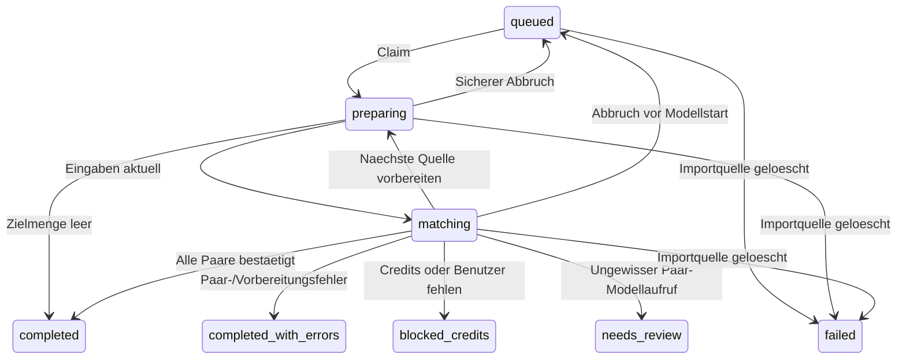
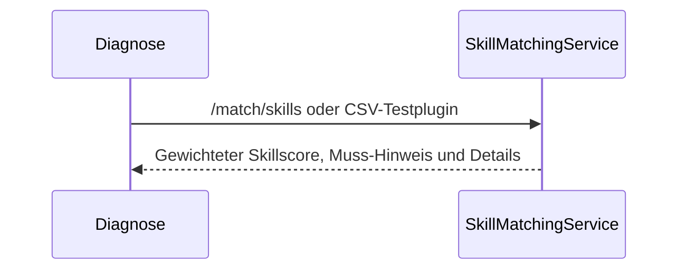
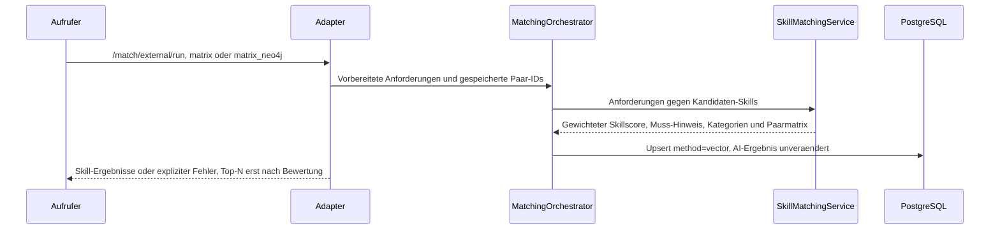
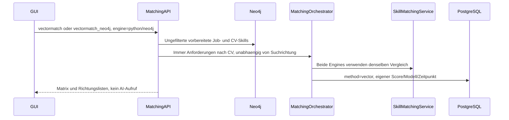
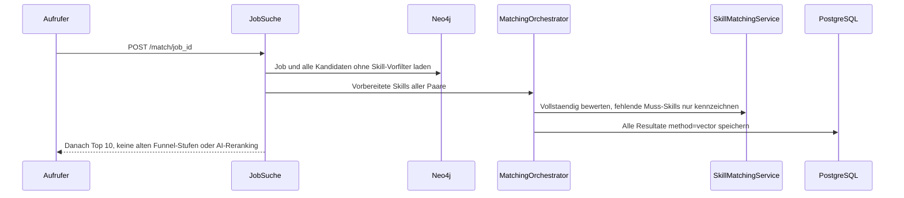
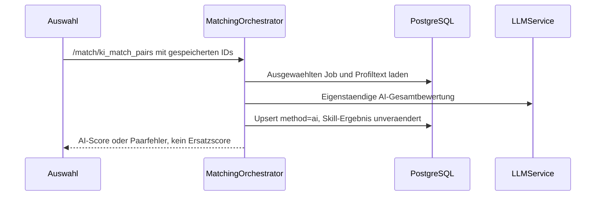

---
# HR Graph Matching API

FastAPI backend mit zwei unabhängigen Matching-Arten: zentrale Skill-Abdeckung für Matrizen/Suchen und AI-Gesamtbewertung ausschließlich ausgewählter gespeicherter Paare.

## Stack
- FastAPI + Uvicorn
- Neo4j official Python driver (async)
- OpenRouter for hosted LLM access, with Ollama as optional local fallback
- Pydantic v2 + pydantic-settings

## Project structure
- `main.py`: FastAPI app and routes
- `models.py`: Pydantic request/response and structured output schemas
- `config.py`: Environment settings
- `services/db.py`: Async Neo4j read/write and unfiltered matching loaders
- `services/matching_orchestrator.py`: Central skill adapters, selected AI pairs and method-isolated persistence
- `services/llm.py`: Structured extraction, embeddings, and reranking
- `scripts/init_neo4j.py`: Creates constraints and vector indexes

## Setup
```bash
python -m venv .venv
source .venv/bin/activate
pip install -r requirements.txt
cp .env.example .env
```

The batch importer reads host, provider, chat model, embedding model, and reasoning settings exclusively from the shared database settings written by the GUI.

```bash
ollama pull <chat-model-from-gui>
ollama pull <embedding-model-from-gui>
```

## Initialize database
```bash
python scripts/init_neo4j.py
```

## Run API
```bash
uvicorn main:app --host 0.0.0.0 --port 8000 --reload
```

## Endpoints
 `POST /cv-parser/parse?persist=false` (multipart field `file`, up to 10 PDF, DOC, DOCX, PNG, JPEG or WebP files; set `persist=true` to store the candidate in Neo4j)

### Gemeinsamer Matching-Vertrag

Der zentrale Adapter `services/matching_orchestrator.py` bereitet bestehende Skillformate auf und delegiert Gesamtwert, Kategorien und Paarmatrix an `SkillMatchingService`. Die Migration der einzelnen Aufrufer wird im OpenSpec-Change `centralize-skill-matching` verfolgt.

| Eingabe / Ausgabe | Vertrag |
|---|---|
| Job-Anforderungen | Vorbereitete `required_skills`, etwa `[{"name": "Python", "priority": "Mandatory", "category": "HardSkill"}]`; keine Extraktion aus Jobtext im schnellen Lauf |
| Priorität | `Mandatory` / `mandatory` / fehlend → `mandatory`; `NiceToHave` / `nice_to_have` → `nice_to_have`; andere Werte sind Eingabefehler |
| Kandidaten-Skills | Skillnamen oder Objekte mit `name`, auch getrennte Namen wie `"Python; SQL"`; leere Kandidaten-Skills sind zulässig |
| Kategorie | Bleibt erhalten; fehlende Kategorie bedeutet für bestehende Formate `HardSkill`; Gesamt- und Kategorieergebnisse verwenden dieselbe gewichtete Abdeckung ohne pauschales Nullsetzen |
| Fehlende Job-Skills | Expliziter Aufbereitungshinweis, keine künstlichen Skills aus Titel/Beschreibung und kein erfolgreicher Nullscore |
| Skill-Abdeckung | `method="vector"`, `score` 0–100 und `qualified`; Embedding-Modellaufrufe bleiben zulässig |
| AI-Matching | `method="ai"`, eigenständiger Gesamtscore 0–100 und `qualified=null`; nur explizit ausgewählte gespeicherte Paare, kein Hybridscore |
| Unabhängigkeit | Fehlende Muss-Skills bleiben Hinweise (`qualified=false`), ohne den gewichteten Skillscore oder einen unabhängigen AI-Score zu überschreiben |
| Legacy-Einheiten | `vectorScore`, `hardSkillScore`, `softSkillScore`, `skill_similarity` und CLI-CSV sind Anteile 0–1, also zentraler Score / 100 |
| Entfallene Diagnosewerte | `vector_score`, `jaccard_score` und `combined_score` in der Job-Suchantwort sind nullable/deprecated, nicht durch andere Scores zu ersetzen |
| Fehlendes Methodenergebnis | Nicht vorhanden beziehungsweise `null`, niemals aus der anderen Methode ableiten |

### Getrennte Paarpersistenz

| Speicherregel | Verhalten |
|---|---|
| Schlüssel | `matching_pair_results`: `(method, candidate_id, job_id)`; die IDs sind PostgreSQL-Primärschlüssel |
| Identität | Numerische IDs, kanonische UUIDs und eindeutig verknüpfte Graph-IDs auflösen; keine Namensschätzung |
| Werte | Je Methode eigener `score` (0–100), `matched_at`, `model` und verfügbare Metadaten; `qualified` nur für Skill-Abdeckung |
| Erneuter Lauf | Nur die ausgeführte Methode aktualisieren; ältere `matched_at` überschreiben keine neueren Ergebnisse |
| Unabhängigkeit | Ein Skill-Update ändert weder AI-Score noch dessen Modell/Zeitpunkt und umgekehrt |
| Fehler | Bewertungs- und Schreibfehler explizit melden; kein Legacy-Ersatzscore und kein Überschreiben alter Ergebnisse durch Fehlerwerte |
| Transaktion | Fehlgeschlagene Paarwrites werden zurückgerollt; `pairsPersisted=true` verhindert zusätzliche Backend-Paarwrites nach bestätigter GraphRAG-Speicherung |
| Diagnose | Direkte Skilllisten-API, CSV-Testplugin und reine Paaranalyse erzeugen keine künstlichen Datenbankpaarungen |
| Historie | Bereits gespeicherte historische Läufe werden nicht neu bewertet; ihre tatsächliche Methode bleibt erhalten |

#### Additives Cache-/Auftragsschema

[PostgresStore.ensure_matching_pair_schema](services/postgres_store.py) besitzt das Versions- und Auftragsschema. Zuerst müssen die gemeinsamen Basistabellen vorhanden sein: die Backend-Tabellen für Benutzer, Credits und interaktive Historie sowie die GraphRAG-Tabellen aus `ensure_schema()`. Danach erstellt die wiederholbare, transaktional gesperrte Erweiterung:

- `matching_pair_evaluations`: vollständiges JSON-Ergebnis pro Methode, PostgreSQL-Paar und Eingabe-Fingerprint; mehrere Versionen bleiben getrennt. CV-/Job-Löschung entfernt alle zugehörigen Versionen einschließlich sensibler Detaildaten.
- `matching_runs`: dauerhafte Aufträge mit eindeutiger optionaler Importereignis-ID, Benutzer-ID, Zustand und zunächst unbekannter Zielanzahl. Zugangstokens werden nicht gespeichert.
- Interaktive Läufe speichern zusätzlich validierte Request-Eingaben, ursprünglichen Tarif und vollständige Abschlussantwort. Löschtrigger entfernen Request-/Antwortinhalte bei CV-/Job-Löschung auch vor der ersten Evaluationszuordnung.
- `matching_run_pairs`: Paarziele eines Auftrags, auch ohne bereits zugeordnete Evaluation. Ihr eigener Schlüssel erlaubt spätere Wiederaufnahme von Vorbereitungsfehlern.
- `matching_pair_results.evaluation_id`: nullable Referenz auf eine Evaluation; die bestehende letzte Paarzusammenfassung bleibt kompatibel.

Das [Node-Backend](../backend/src/matchingPairs.js) darf zuerst starten: Es ergänzt nullable Evaluations-/Historienreferenzen und den eindeutigen Historienindex, ohne GraphRAG-Versionstabellen vorauszusetzen. GraphRAG ergänzt später die Fremdschlüssel. Alte Werte, Modelle und Zeitpunkte bleiben unverändert und erhalten keinen erfundenen Fingerprint. Ohne überprüfbare Evaluation sind diese Ergebnisse **unverifiziert**, nicht gültige Cache-Treffer. Legacy-Writes lösen die Referenz beim tatsächlichen Überschreiben; ignorierte ältere Writes verändern sie nicht.

Importereignisse können mit derselben PostgreSQL-Verbindung wie der Import geschrieben werden; ein Rollback verwirft beide Änderungen. Wiederholte Zustellung derselben Ereignis-ID liefert denselben Auftrag. Diese Schema-Erweiterung allein aktiviert weder automatische Importe noch einen Worker und führt keine historischen Neuberechnungen aus.

| Importpersistenz | Verhalten |
|---|---|
| CV | Datensatz, vollständiges Strukturprofil ohne Identitätsfelder im Matching-Profil, Volltext, Anonymisierung und Auftrag werden in einer Transaktion gespeichert |
| Job | Importierte Beschreibung, Anforderungen und vollständiges Skillprofil werden mit dem Auftrag atomar gespeichert; Reimport darf manuell bearbeitete importierte Inhalte ersetzen |
| Identität und CRM | Job-ID, Status und bestehende CRM-Zuordnungen bleiben bei Aktualisierung erhalten |
| Unverändert | Identische Jobversion oder übersprungene CV-Identitätsdublette erzeugt keinen weiteren Auftrag |
| Paralleler Reimport | PostgreSQL-Sperre und Eindeutigkeitsindizes verhindern zwei Aufträge für dieselbe gleichzeitig importierte Änderung |
| Graph-Fehler nach CV-/Job-Speicherung | Import und Auftrag bleiben erhalten; `preparationStatus=required` und `preparationError=graph_preparation_failed` statt Löschen des Imports |
| Fehlender Benutzer | Persistierende Python-Import-APIs prüfen den aktuellen Benutzer vor der Importabbuchung; direkte Persistenz ohne Benutzer erzeugt einen mit `missing_actor` blockierten Auftrag |

| Python-Import-/Sync-Vertrag | Verhalten |
|---|---|
| `/cv-fast-importer/import`, `/cv-parser/parse`, `/ingest/candidate`, `/ingest/job` | Gespeicherte Imports liefern `matchingRunId`, `matchingStatus=queued`, `matchingStatusUrl=/matching/runs/{id}` und den getrennten `preparationStatus`; noch kein Matching-Abschluss |
| CV-Parser-Antwort | Metadaten zusätzlich unter `graphRag`; `storage.neo4j` ist nur nach bestätigter Aufbereitung wahr, nicht bereits wegen einer vergebenen UUID |
| `persist=0` | Keine Quelle, kein Auftrag, keine Graph-Embeddings; bisherige Parsing-Tarife bleiben unverändert |
| Job mit `persist=postgres` | Quelle und Auftrag ohne Graph-Zugriff; `preparationStatus=required` |
| `/sync/candidates`, `/sync/jobs` | Kein weiterer Importauftrag; `preparedRevisions` enthält nur erfolgreich bestätigte PostgreSQL-Revisionen |
| Aktuelle Skills | Aktuelle PostgreSQL-Namen einschließlich gelöschter Skills sind führend; Kategorien und Jobprioritäten verbleibender Namen bleiben erhalten |
| Parallelität und Änderungen | Aufbereitung je Quelle über PostgreSQL serialisiert; konsistenter Quellsnapshot vor Modellaufrufen, Versionsprüfung vor Bestätigung; keine SQL-Transaktion während Modellaufrufen |
| Nur Graph aktualisiert | Abweichendes Profil oder Graph-ID bestätigt keine PostgreSQL-Revision; `stored_profile_differs` beziehungsweise `graph_identity_differs` und ausstehender Abgleich statt falschem Vorbereitungs-Erfolg |

`matching_prepared_revision` auf CVs und Jobs ist ein Inhaltsnachweis, kein zeitbasierter Erfolgsschalter. Ändert sich die Quelle während der Aufbereitung, meldet Sync einen Fehler ohne vorbereitete Revision. Worker, GraphRAG-Admin-APIs einschließlich Retry und die geschützte GUI unter Administration → Batchverarbeitung sind eingebunden.

| Node-CV-/CSV-Import | Verhalten |
|---|---|
| Backend-Start vor GraphRAG | Wiederholbares `matching_runs`-Basisschema unter derselben PostgreSQL-Migrationssperre; GraphRAG ergänzt das vollständige Auftragsschema |
| CV-Parser | Kandidat, Werdegang, Ausbildung, Volltext, Strukturprofil und Importauftrag in einer Transaktion; `matchingRunId`, `matchingStatus` und Node-Status-URL zusätzlich in der Antwort |
| CSV | Genau ein Auftrag je gespeicherter neuer Zeile; `matchingRuns` nennt CSV-Zeile, Kandidaten-ID und Laufmetadaten |
| Vorschau und Dublette | Kein neuer Auftrag; CSV-Fehler rollen die betroffene Quelle samt Auftrag zurück, andere gültige Zeilen bleiben erhalten |
| Verschachtelte Schreibhelfer | PostgreSQL-Savepoints statt vorzeitigem Commit der äußeren Importtransaktion |
| Gleichzeitige Imports | Eigene asynchrone PostgreSQL-Verbindung je Import; Schreibhelfer verwenden die aktive Verbindung, übrige synchrone Backend-Zugriffe bleiben unverändert |
| Aufbereitung | Asynchroner Graph-Sync nach Commit, keine synchronen Paarbewertungen; vollständiges Profil auch bei CSV ohne CV-Datei gespeichert |
| Benutzer | Aktueller DB-Benutzer wird im Import gesperrt und dem Auftrag zugeordnet; fehlender Benutzer erzeugt ausdrücklich `blocked_credits`/`missing_actor` statt kostenloser Berechnung |

Der zunächst reproduzierte Parallelfehler `25P01` im gemeinsam genutzten synchronen Node-Client wird durch getrennte asynchrone Importtransaktionen behoben.

| CRM-Import | Verhalten |
|---|---|
| Finaler Kontext | CRM-UUID, Name, Labels, CV-Strukturprofil, Werdegang, Dateimetadaten und genau ein Auftrag werden gemeinsam bestätigt; Graph-Sync und Audit erst nach Commit |
| Geändertes CV oder Name | Genau ein eigener Auftrag; alte Anonymisierung wird verworfen, unveränderte CVs werden nicht erneut vom Sprachmodell ausgelesen |
| Unverändert / nur Labels | `matchingStatus=not_required`; kein weiterer Auftrag oder Graph-Aufruf, vorhandene Anonymisierung bleibt erhalten |
| Dateisicherheit | Neue Datei vorab bereitgestellt; Rollback entfernt sie, alte Dateien werden erst nach erfolgreichem Commit gelöscht |
| Parallelzustellung | Pro CRM-UUID serialisiert; parallele Wiederholungen erzeugen weder zusätzliche Datensätze noch Dateien oder Aufträge |
| Graph-Sync | Verwendet gespeicherte IDs und den finalen Quellstand; legt keinen zweiten Auftrag an und verschweigt Teilfehler nicht |

| Node-Job-Import | Verhalten |
|---|---|
| `/api/jobs` mit `graphRagProfile` | Vollständiges Profil einschließlich Skillkategorien/-prioritäten, Quelltext und Auftrag atomar gespeichert; Graph-Aufbereitung erst nach Commit |
| `/api/jobs/parse-description?persist=1` | Zuerst reine Extraktion, danach dieselbe atomare Speicherung; Antwort mit `matchingRunId`, `matchingStatus`, `matchingStatusUrl` und Vorbereitungsstatus |
| Tatsächlich geänderter Reimport | Importierte Inhalte werden aktualisiert; ID, UUID, Status und CRM-Zuordnungen bleiben bestehen; genau ein neuer Auftrag |
| Unveränderter Reimport | HTTP 200, `matchingStatus=not_required`, kein weiterer Auftrag oder Graph-Schreibaufruf; manuelles Anlegen einer Dublette ohne Importprofil bleibt HTTP 409 |
| `persist=0` / `extractOnly=1` | Keine Quelle und kein Auftrag; `importSteps.graphRagSaved.ok=false` |
| Fehler | Enqueue-Fehler rollen auch neue/geänderte Quelldaten zurück; Graph-Fehler nach Commit behalten Quelle und Auftrag mit `preparationStatus=required` und konkretem Fehler |

| jobs.ch-Import | Verhalten |
|---|---|
| Benutzer | `/plugins/jobs_ch/import-db` prüft den aktuellen PostgreSQL-Benutzer vor Importtarif, Abruf und Schreibzugriff |
| Neue/geänderte Daten | Vollständiges Importprofil und Auftrag atomar; jedes Item nennt Lauf-/Status-URL und Vorbereitungsstatus, ID und Status bleiben bei Reimport erhalten |
| Unverändert | `matchingStatus=not_required`; kein weiterer Auftrag, keine Embeddings und kein Graph-Schreibaufruf |
| Aufbereitung | Derselbe versionierte Aufbereitungsweg wie `/sync/jobs`; keine zweite Skill-/AI-Paarberechnung im Import |
| Graph-Fehler | Import bleibt erfolgreich gespeichert; Item mit `preparationStatus=required`, Fehlerdetail und zusätzlicher Aufbereitungswarnung |

Abgedeckt durch [Cache-/Migrationstests](tests/test_matching_cache.py), [Auftragstests](tests/test_matching_pipeline.py) und [Backend-Persistenztests](../backend/src/__tests__/matching-exports.test.js), jeweils gegen isoliertes PostgreSQL.

#### Versionsabhängiger Paar-Cache

[MatchingOrchestrator](services/matching_orchestrator.py) plant produktive Skill-Matrizen und ausdrücklich ausgewählte AI-Paare über [MatchingPairCache](services/matching_cache.py). Ein Treffer liefert das vollständige Originalergebnis ohne Embedding-/AI-Aufruf, erneutes Scoring oder erneuten Paarwrite. Numerische IDs und UUIDs werden vor der Planung auf dieselben PostgreSQL-IDs aufgelöst; beide Skill-Engines verwenden denselben Cache.

| Fingerprint | Inhalt |
|---|---|
| Gemeinsam | Kanonisches Paar, Methode, gespeicherte Matching-Nutzdaten und tatsächlich bewertete geordnete Eingaben |
| Skill | Effektiver Embedding-Provider/-Endpunkt/-Modell, Dimensionen, Cutoff, Bewertungsregel und relevante ESCO-Konzepte samt Aliasen/Beschreibungen |
| AI | Effektiver Chat-Provider/-Endpunkt/-Modell, Promptinhalt/-version, feste Rangfolge-/JSON-Anweisung, Generierungsparameter und Reasoning |
| Ausgeschlossen | API-Schlüssel, URL-Zugangsdaten, Zugriffslogs und irrelevante Änderungs-/Zugriffszeitpunkte; fremde Methodenkonfiguration |

Modell- und Prompt-Snapshots werden auch beim tatsächlichen Provideraufruf verwendet. Spätere Konfigurationsänderungen wechseln nicht heimlich das Modell einer laufenden Berechnung. Für verifizierte Ergebnisse gibt es keinen synthetischen Embedding-Fallback und keine verdeckte Wiederholung ungewisser Provideraufrufe.

Ein aktiver PostgreSQL-Claim wird geteilt statt doppelt bewertet. Lease/Heartbeat und Fencing verhindern verspätete Writes; ein abgelaufener Claim ohne Modellstart kann übernommen werden. Nach einem Modellstart ohne bestätigten Abschluss bleibt er dagegen `needs_review`. Vollresultat, aktuelle Paarprojektion und erfolgreicher Abschluss werden in einer Transaktion gespeichert. Vor Veröffentlichung werden die gespeicherten Nutzdaten und die effektive SQL-Konfiguration erneut geprüft; zwischenzeitlich überholte Ergebnisse ersetzen die aktuelle Projektion nicht.

`cacheStatus` unterscheidet `computed` und `hit`; `evaluationId` bezeichnet die gespeicherte Version und `matchedAt` bleibt der ursprüngliche Paarzeitpunkt. Ein bestätigter Score `0` und `qualified=false` sind gültige Ergebnisse. Beispiel: Python gedeckt, SQL ungedeckt, beide verpflichtend → **50 Prozent**, `qualified=false`; ein ausgewählter AI-Score von beispielsweise 85 bleibt davon unabhängig. Änderungen am AI-Prompt berechnen keine Skill-Ergebnisse und starten kein automatisches AI-Matching.

Die produktiven Routen in [matching_api.py](matching_api.py) validieren einen bestehenden Benutzer und legen einen dauerhaften interaktiven Lauf an. Erst nach Cache-/Claim-Planung wird bei eigenen fehlenden Berechnungen einmal laufbezogen abgebucht; reine Treffer und Joins sind kostenlos. Der bisherige Routentarif bleibt erhalten, auch `AI_MATCH` mit 1,00 Credits für das schnelle `/match/external/run`. Bei Credit-Mangel startet kein Modellaufruf; ungestartete, unberechnete Claims werden ohne Abbuchung freigegeben. Bereits bezahlte Claims werden dabei nicht freigegeben. Die Antworten behalten die angefragte ID-Form für bestehende Rankings; der interne Cache verwendet weiterhin kanonische PostgreSQL-IDs.

[MatchingRequestCoordinator](services/matching_pipeline.py) begrenzt das Warten auf produktive Matching-Antworten auf zehn Sekunden. Läuft eine Berechnung länger oder arbeitet ein anderer Eigentümer, folgt HTTP 202 mit `status="pending"`, `runId`, `statusUrl`, `pendingPairs` und `availableResults`; Pending enthält keinen erfundenen Score. Eine rechtzeitig fertige Antwort behält ihre bisherige Erfolgsform mit ergänzter Lauf-ID und Status-URL. Die Job-Suche reicht dieselben ursprünglichen Paarzeitpunkte und Cache-/Modellmetadaten weiter.

Der FastAPI-Lifespan nimmt dauerhafte interaktive Anfragen mit Run-Lease/Heartbeat wieder auf und beendet eigene Tasks geordnet vor dem Schließen der Clients. Nach Abbruch vor Modellstart wird derselbe Lauf mit aktuellen Quelldaten/effektiver Konfiguration neu geplant; eine bestehende Laufabbuchung bleibt idempotent. Explizit übergebene Skill-Eingaben bleiben dabei erhalten, graphbasierte Wege laden ihre Eingaben neu. Nach möglicherweise begonnenem Modellaufruf bleibt der Lauf dagegen `needs_review` und wird nicht automatisch wiederholt.

| Interaktiver Proxy | Vertrag |
|---|---|
| HTTP 202 | Alle produktiven Node-Matchingrouten erhalten `runId`, `statusUrl`, verfügbare Resultate und ausstehende Paare; Pending ist kein Nullscore und kein Paarfehler |
| Eigener Status | `GET /matching/runs/{runId}` in GraphRAG, `GET /api/matching/runs/{runId}` im Backend; Eigentümer oder aktuell gespeicherter Admin, sonst 404 |
| Abschluss | Node speichert den serverseitigen Antwortkontext ohne Token in `matching_runs.client_context`; Polling liefert die bisherige Erfolgsform unter `resultPayload` |
| Historie | Bestehende Historienrouten schreiben höchstens eine Zeile je `matching_run_id`; wiederholtes Abschluss-Polling ersetzt weder Review noch Ergebniszeitpunkt oder Paarprojektion |
| Auswahl mehrerer Stellen | `POST /match/vectormatch-selected` hält alle ausgewählten Paare und lokalen Fehler in einem dauerhaften Sammelauftrag zusammen; je Stelle ein dauerhafter Teillauf |
| Tarif der Auswahl | Sammelauftrag kostenlos; bestehende 0,10 Credits je Stellen-Teillauf mit eigener Neuberechnung; reine Hits/Joins kostenlos |
| Quellenlöschung | Request, Antwort, Node-Kontext und verknüpfte Historieninhalte werden bereinigt; ein späterer Abschluss kann sie nicht neu anlegen |

| Status / Tarif | Vertrag |
|---|---|
| 200 | Ursprüngliche Erfolgsform mit ergänzten Lauf-/Cache-Metadaten; vorhandene Score-Einheiten bleiben unverändert |
| 202 | Dauerhafter Lauf offen; `statusUrl` statt eines neuen Matching-POSTs pollen |
| 401 / 404 | Fehlende gültige Benutzeridentität / unbekannter oder nicht zugreifbarer Lauf |
| 402 | Credits fehlen; kein Modellstart ohne erfolgreiche Abbuchung |
| 409 | Benutzer oder Quelldaten zwischenzeitlich entfernt beziehungsweise Lauf nicht mehr verfügbar |
| 422 / 502 / 503 | Ungültige Eingaben / ungültige Proxyantwort / Bewertung oder Persistenz fehlgeschlagen; kein erfolgreicher Ersatzscore |
| Interaktiv | Bisheriger Routentarif nur bei eigener Neuberechnung, einmal je dauerhaftem Lauf |
| Automatischer Import | 0,10 Credits einmal je Importlauf mit eigener Neuberechnung, nicht je Paar; reine Hits, Joins und leere Zielmengen kostenlos |
| Importkosten | Bestehende Parsing-/Importtarife bleiben davon unabhängig; keine automatische AI-Massenbewertung |

Die Cache-/Request-/Worker-Tests verwenden ausschließlich isoliertes PostgreSQL und deterministische HTTP-Modelldoubles. Die GUI zeigt Queue, echte Zähler und bestätigte Wiederaufnahme; Importdialoge verlinken auf Admin- beziehungsweise Eigenstatus. Laufende ausgewählte Matchings werden über dieselbe Auftrags-ID fortgesetzt, alte Historienwerte ohne Gültigkeitsnachweis explizit gekennzeichnet. Bedienpfade und Hinweise stehen im [Benutzerhandbuch](../README.md#cache-und-asynchrone-batchverarbeitung). Das ist keine Freigabe für ungeprüfte Live-Modellaufrufe oder ein Produktionsdeployment.

| GraphRAG-Batch-/Eigenstatus | Vertrag |
|---|---|
| `GET /admin/batches/summary` | Aktuell gespeicherter Admin; Queue-Zahlen für wartende, aktive, kreditblockierte, prüfbedürftige, fehlgeschlagene und mit Fehlern abgeschlossene Läufe |
| `GET /admin/batches` | Aktuell gespeicherter Admin; Filter `status` und `source`; `limit` 1–100, Standard 25; UUID-`cursor`; `items` enthalten jeweils `run` und `counters`, dazu `nextCursor` |
| `GET /admin/batches/{runId}` | Admin; `run`, ungefilterte `counters`, paginierte `pairs`, `nextCursor`; Filter `pairStatus`, positiver Paarziel-ID-`cursor` aus diesem Lauf, dieselben Seitengrenzen |
| Eigener Lauf | Bestehendes `GET /matching/runs/{runId}` enthält zusätzlich `counters`; Originalergebnis bleibt unter `resultPayload`; Fremdzugriff 404, fehlender Benutzer/Bearer 401 |
| Rolle / Fehler | Globaler Zugriff ohne gespeicherte Adminrolle 403, API-Key allein 401; unbekannte/fremde Cursor oder ungültige Filter 422; Fehler nur als bekannte Codes, sonst `matching_failed` |
| Paardetails | `pairId` ist die Ziel-ID, nicht `evaluationId`; ursprüngliche CV-/Job-IDs und `matchedAt` bleiben erhalten; Fehler haben kein Ersatzresultat, spätere Cache-Treffer `cacheStatus="hit"` |
| `POST /admin/batches/{runId}/retry` | Admin; `{ "pairIds": [123], "confirmUncertain": false }`, 1–100 eindeutige positive Ziel-IDs; Antwort `{ "runId": "...", "stage": "queued" }`; kein neuer Import oder Lauf |
| Retry-Schutz | HTTP 409 bei aktivem Worker, laufenden/gültigen Paaren, fremden Ziel-IDs, gelöschten Quellen oder fehlendem Benutzer; bei ungewissem Modellaufruf erst nach `confirmUncertain=true`, Hinweis auf mögliche zusätzliche Providerkosten |
| Auswahl / Audit | Nur ausgewählte Paare neu prüfen, andere gültige Originalresultate auch bei inzwischen geänderten Eingaben unverändert übernehmen; nicht freigegebene wartende Ziele explizit `failed` / `retry_not_selected`, später einzeln freigebbar; Audit hält Admin, Ziel, Evaluation, Zeitpunkt und Entscheidung ohne CV-Text fest |
| Geteilte Wiederholung | Ursprünglichen Eigentümerlauf einschließlich notwendiger Eltern/Teilläufe wiederaufnehmen, beitretender Lauf wartet kostenlos; vorhandene Abbuchung bleibt erhalten |
| Node-Proxy | Dieselben Payloads über `GET /api/batches`, `GET /api/batches/{runId}` und `POST /api/batches/{runId}/retry`; `Authorization: Bearer …` wird weitergereicht, API-Key ersetzt keine Benutzerrolle; aktueller Admin in beiden Diensten geprüft |
| Import-Eigenstatus im Backend | `GET /api/matching/runs/{runId}` funktioniert auch ohne Node-Matchingkontext; bestehende Node-Matchings behalten ihre Abschlussform und idempotente Historie |

#### Automatischer Import-Worker

[MatchingImportWorker](services/matching_pipeline.py) startet mit dem FastAPI-Lifespan, nicht mit dem Browser. Es gibt keinen zusätzlichen Broker oder separaten Worker-Startbefehl.

| Vertrag | Verhalten |
|---|---|
| Grenzen | Höchstens zwei aktive Importläufe pro Prozess; alle drei Sekunden bis zu fünf wiederaufnehmbare Läufe prüfen; Paarblöcke mit 25 Zielen |
| Feste Menge | Alle beim Expandieren gespeicherten Gegenstücke, unabhängig von Status, Skill-Namensüberschneidung oder Top-N; spätere Imports ändern den Nenner nicht |
| Aufbereitung | Aktuelle PostgreSQL-Revision vor Graph-Lesen und Paar-Modellaufrufen prüfen; vorhandenen Sync-Callback nur bei fehlender/veralteter Vorbereitung verwenden |
| Fehlerisolation | Fehlende Anforderungen: `preparation_required` / `missing_job_skills`, kein Nullscore; andere bewertbare Paare laufen weiter |
| Löschung | Gelöschtes Gegenstück bleibt als `skipped` im festen Nenner; gelöschte Importquelle beendet ihren eigenen Lauf und entfernt sensible Antwort-/Historieninhalte |
| Wiederaufnahme | Ohne begonnenen Paar-Modellaufruf aktueller Quell-/Konfigurationsstand im selben Lauf; bereits bestätigte Ergebnisse behalten Score, ursprünglichen Zeitpunkt und Zuordnung als neu berechnet |
| Zugeordneter Claim | Andere Läufe warten kostenlos; nach Lease-Verlust setzt ein Worker den ursprünglichen Lauf fort, statt für dessen bereits bezahlte Arbeit neu abzubuchen |
| Provider-Ungewissheit | Nach möglicherweise begonnenem Paar-Modellaufruf ohne bestätigtes Ergebnis `needs_review`; kein automatischer zweiter Aufruf, auch nicht nach Neustart |
| Fortschritt | Bestätigte Evaluationen und gespeicherte Paarstände, einschließlich laufender Kinder eines Sammelauftrags; drei neue + zwei Cache-Treffer + ein Fehler + zwei ausstehend = 6/8 = 75 Prozent |
| Unbekannt / leer | Unbekannte Zielmenge: `progressPercent=null`; bestätigt leere Menge: abgeschlossen, null Abbuchungen; Fehler-/Prüfzustände bleiben getrennt von gültigen Scores |



| Betrieb / Rollback | Vorgehen |
|---|---|
| Start / Neustart | GraphRAG regulär starten; vorhandene offene Import- und interaktive Läufe werden aus PostgreSQL übernommen, ohne neue Importereignisse oder globale Neuberechnung |
| Lease | Lauf und Evaluation jeweils 60 Sekunden; Heartbeat alle 20 Sekunden; verspätete Eigentümer dürfen keine neue Reservierung verdeckt übernehmen |
| Geordneter Stop | Zuerst Polling und noch nicht gestartete lokale Tasks stoppen; aktive Importläufe bis zu 30 Sekunden drainen, danach abbrechen; anschließend interaktive Läufe drainen und erst danach Graph-/Modellclients schließen |
| Stop-Frist | Prozess-/Container-Grace-Period für beide Drain-Phasen plus Clientabschluss auslegen, beispielsweise mindestens 75 Sekunden; ein harter Abbruch kann `needs_review` hinterlassen |
| Blockierte Läufe | Konkreten Benutzer-/Credit-/Vorbereitungsfehler beheben und betroffene Ziel-IDs über die geschützte Retry-API freigeben; erst ohne aktiven Worker; keine Quelle erneut importieren oder alternativen Benutzer einsetzen |
| Rollback vorbereiten | Import- und Matchingzugriffe sperren, GraphRAG geordnet stoppen; kompatiblen Stand ohne automatische Enqueues/Worker bereitstellen |
| Daten erhalten | Aufträge, Ergebnisversionen und Credit-Transaktionen nicht löschen; ohne cachekompatiblen Rollback-Stand Matchingverkehr gesperrt lassen, keine offenen Paare durch Legacy-Matcher neu berechnen |

### Skill-Matching

`POST /match/skills` bewertet jede Anforderung gerichtet gegen den besten vorhandenen Kandidaten-Skill. Der Endpunkt nutzt den lokalen ESCO-Katalog und das konfigurierte Embedding-Modell; eine leere `has_skills`-Liste ist zulässig, `need_skills` muss mindestens einen Eintrag enthalten.

```json
{
  "need_skills": [
    {"name": "Python programming", "priority": "mandatory"},
    {"name": "Cloud deployment", "priority": "nice_to_have"}
  ],
  "has_skills": ["Python", "AWS deployment"]
}
```

Jeder Treffer enthält den besten Kandidaten-Skill, ESCO-Auflösung, rohe und gewertete Ähnlichkeit, Abdeckungsstatus und Begründung. `qualified=false` bedeutet, dass mindestens ein Muss-Skill fehlt; es ist nur ein Hinweis und setzt den Gesamtscore nicht auf 0. `missing_skills` benennt ungedeckte Anforderungen samt Grund.

```json
{
  "score": 67,
  "qualified": true,
  "cutoff": 0.75,
  "matches": [
    {
      "need_skill": "Python programming",
      "need_esco_uri": "http://data.europa.eu/esco/skill/...",
      "need_resolution_status": "resolved",
      "has_skill": "Python",
      "has_esco_uri": "http://data.europa.eu/esco/skill/...",
      "has_resolution_status": "resolved",
      "similarity": 1.0,
      "weighted_similarity": 1.0,
      "priority": "mandatory",
      "covered": true,
      "match_type": "canonical",
      "reason": "Identische kanonische ESCO-URI."
    }
  ],
  "missing_skills": [
    {
      "name": "Cloud deployment",
      "priority": "nice_to_have",
      "reason": "Semantische Ähnlichkeit 0.0000 liegt unter dem Cutoff 0.75."
    }
  ]
}
```

### Matching-Aufrufe und Sequenzen

| Gruppe | Eintrittspunkte | Verhalten |
|---|---|---|
| Direkte Diagnose | `POST /match/skills`, CSV-Testplugin | Zentraler Vergleich ohne Paarpersistenz |
| Matrix / Listen | `POST /match/external/run`, `/match/external/matrix`, `/match/external/matrix_neo4j` | Vorbereitete Skills und gespeicherte IDs; nur Skill-Abdeckung |
| Graph / beide Richtungen | `POST /match/vectormatch`, `/match/vectormatch_neo4j`; `engine=python` oder `neo4j` | Graph lädt Skills; beide Engines bewerten ausschließlich zentral, nicht per Cypher-Cosinus |
| Job-Suche | `POST /match/{job_id}` | Alle Kandidaten zentral bewerten und speichern, danach Top 10; kein AI-Reranking |
| Job-Suchzähler | `stage1_count`, `stage2_count` | Legacy-Feldnamen für geladene beziehungsweise bewertete Kandidaten; keine alten Funnel-Stufen |
| AI-Auswahl | `POST /match/ki_match_pairs` | 1–20 explizite gespeicherte Paare; jedes erfolgreiche AI-Ergebnis getrennt speichern, Paarfehler in `failures` |
| Fehlergrenze | Produktive API-Antworten | `pairsPersisted=true` erst nach bestätigten Paarwrites; ungültige Vorbereitung/IDs ergeben Fehler statt Scores |

#### 1. Direkter Skillvergleich und CSV-Testplugin


#### 2. Externe Listen und Matrizen


#### 3. Graphbasierte Suche in beiden Richtungen


#### 4. Job-Suche mit Top 10


#### 5. Explizit ausgewaehlte AI-Paare


Beispiel für produktive Skill-Abdeckung:
```json
{
  "jobs": [{"id": 2, "title": "Engineer", "required_skills": [{"name": "Python", "priority": "Mandatory"}]}],
  "candidates": [{"id": 7, "name": "Ada", "has_skill": [{"name": "Python"}]}],
  "engine": "python"
}
```

Beispiel für explizites AI-Matching: `{"pairs":[{"jobId":2,"candidateId":7}]}`. Beide IDs müssen bereits gespeichert sein; fehlende Profiltexte werden als Fehler gemeldet.

Die Sequenzen **6. Batch/CSV/Importhinweise** und **7. reine CLI-Diagnose** stehen bei den [Batch-Aufrufen](#batch-suche-csv-matrix-und-diagnose).

### Deprecated: vollstaendiges Skillscorer-Inventar

Die folgenden Implementierungen sind in ihren Docstrings als deprecated gekennzeichnet. Referenzcode ist nicht als Route registriert und wird von keinem produktiven Einstieg verwendet; er ist insbesondere kein Fehler-Fallback. Unterstützte HTTP-/CLI-Aufrufe bleiben bestehen und delegieren zentral.

| Datei | Alte Implementierung | Status und Ersatz |
|---|---|---|
| [matching_api.py](matching_api.py) | `score_skill_pair`, `score_vector_pair_for_skills`, `score_vector_pair` | Inaktive Referenzen → `MatchingOrchestrator.match_skill_matrix` / `SkillMatchingService` |
| dieselbe Datei | `cosine_similarity`, `lexical_similarity`, `skill_weight`, `build_skill_embedding_cache`, `normalize_skill_entries`, `normalize_vector_skill_entries`, `get_required_skills`, `get_candidate_skills` | Nur Legacy-Helfer → zentrale Normalisierung, Auflösung, Embeddings, Gewichte und Gate; kein Text-als-Skill-Fallback |
| dieselbe Datei | `_score_pair`, `score_pair`, `overlap_score`, `build_results`, `build_matrix`, `_deprecated_ki_match_pairs` | Inaktive alte Paar-/Fallback-Komposition → Skill-Matrix oder ausdrücklich ausgewähltes `match_ai_pair`, niemals Hybrid |
| dieselbe Datei | `build_neo4j_vector_result.category_score`, `build_neo4j_vector_result`, `_deprecated_vector_match_neo4j` | Inaktive alte Kategorienachberechnung → zentrale Gesamt-/Kategorieergebnisse |
| [services/db.py](services/db.py) | `get_vectormatch_neo4j_rows`, darin `_best_match_list`, `_priority_weight_expression` | Inaktives Cypher-Scoring → ungefilterter Loader und zentraler Orchestrator |
| dieselbe Datei | `get_top_job_matches_for_candidate`, `get_top_candidate_matches_for_job` | Deprecated **delegierende Fassaden** mit explizitem Orchestrator; frühere Overlap-Bodies nur noch `_deprecated_top_job_matches_by_overlap` / `_deprecated_top_candidates_by_overlap` |
| dieselbe Datei | `stage1_filter_candidates`, `stage2_rank_candidates`, `_jaccard_similarity`, `_score_from_matched_skills` | Inaktive Funnel-/Jaccard-Referenzen bzw. historische Regressionstests → vollständiger zentraler Vergleich vor Top-N |
| [batch_tools/matrix.py](batch_tools/matrix.py) | `_find_similar_skills`, `_score_pair`, `_deprecated_build_matrix` | Inaktive Nachbar-/Unionbewertung → `_build_matrix` mit zentral gespeicherten Scores und CSV-Skalenadapter |
| [batch_tools/describe_candidate_job.py](batch_tools/describe_candidate_job.py) | `_load_top_cosine_pairs`, `_collect_skill_names`, `_build_skill_embedding_cache`, `_dot_product`, `_vector_norm`, `_vector_similarity_report` und frühere Skillrechnung in `run` | Inaktive Skill-Diagnosereferenzen → `_print_skill_matching` und zentrale vollständige Paarmatrix |
| dieselbe Datei | `_cosine_similarity` | Für Skills deprecated; aktiv ausschließlich in ausdrücklich getrennter Ganzdokument-Diagnostik, ohne Skill-/AI-Ergebnis oder Paarwrite |

`LLMService.rerank_candidates` bleibt die unterstützte **unabhängige AI-Gesamtbewertung**; sie ist nicht deprecated. Backend und GUI starten sie ausschließlich über ausgewählte gespeicherte Paare, nicht automatisch für Matrizen oder wegen eines Skill-Gates.

## Graph schema (Neo4j)

### Core nodes
- `Candidate`
	- properties: `id`, `name`, `location`, `experience_years`, `yearsOfExperience`, `salaryExpectation`, `embedding`
- `Job`
	- properties: `id`, `title`, `company`, `department`, `location`, `employmentType`, `embedding`

### Bridge nodes
- `Skill`
	- properties: `name`, `category`
- `Language`
	- properties: `name`
- `Education`
	- properties: `level`, `fieldOfStudy`
- `Industry`
	- properties: `name`

### Relationships
- `(Candidate)-[:HAS_SKILL {yearsOfExperience, level}]->(Skill)`
- `(Job)-[:REQUIRES_SKILL {priority}]->(Skill)`
- `(Candidate)-[:SPEAKS {level}]->(Language)`
- `(Job)-[:REQUIRES_LANGUAGE {level}]->(Language)`
- `(Candidate)-[:HAS_DEGREE]->(Education)`
- `(Job)-[:REQUIRES_DEGREE]->(Education)`
- `(Candidate)-[:HAS_INDUSTRY]->(Industry)`
- `(Job)-[:IN_INDUSTRY]->(Industry)`

### Initialize / refresh schema
Run the schema initializer after model changes:

```bash
python scripts/init_neo4j.py
```

### Cypher examples

Show one candidate-job subgraph with shared bridge nodes:

```cypher
MATCH (c:Candidate)-[hs:HAS_SKILL]->(s:Skill)<-[rs:REQUIRES_SKILL]-(j:Job)
OPTIONAL MATCH (c)-[sp:SPEAKS]->(l:Language)<-[rl:REQUIRES_LANGUAGE]-(j)
OPTIONAL MATCH (c)-[:HAS_DEGREE]->(e:Education)<-[:REQUIRES_DEGREE]-(j)
OPTIONAL MATCH (c)-[:HAS_INDUSTRY]->(i:Industry)<-[:IN_INDUSTRY]-(j)
WITH c, j,
	 collect(DISTINCT {skill: s.name, candidateLevel: hs.level, candidateYears: hs.yearsOfExperience, jobPriority: rs.priority}) AS shared_skills,
	 collect(DISTINCT {language: l.name, candidateLevel: sp.level, requiredLevel: rl.level}) AS shared_languages,
	 collect(DISTINCT {degreeLevel: e.level, field: e.fieldOfStudy}) AS shared_degrees,
	 collect(DISTINCT i.name) AS shared_industries
RETURN c.id AS candidate_id,
	   c.name AS candidate_name,
	   j.id AS job_id,
	   j.title AS job_title,
	   j.company AS company,
	   shared_skills,
	   shared_languages,
	   shared_degrees,
	   shared_industries
LIMIT 1;
```

Find top candidate-job pairs by number of mandatory shared skills:

```cypher
MATCH (j:Job)-[rs:REQUIRES_SKILL {priority: 'Mandatory'}]->(s:Skill)<-[:HAS_SKILL]-(c:Candidate)
WITH j, c, count(DISTINCT s) AS mandatory_skill_overlap
WHERE mandatory_skill_overlap > 0
RETURN j.id AS job_id,
	   j.title AS job_title,
	   c.id AS candidate_id,
	   c.name AS candidate_name,
	   mandatory_skill_overlap
ORDER BY mandatory_skill_overlap DESC, job_id, candidate_id
LIMIT 25;
```

## Tests

### Abschlussprüfung: Cache und Import-Queue

Getestet wurde ausschließlich gegen die isolierte PostgreSQL-Datenbank `hrtool_test` auf `127.0.0.1:55432` beziehungsweise im freigegebenen Node-Linux-Testcontainer. Embedding-/AI-Antworten waren deterministische Doubles; keine Produktionsdaten, echten Provideraufrufe oder kostenpflichtigen Modelltests.

| Prüfung | Ergebnis |
|---|---|
| Python: Cache, Pipeline, Billing, Skill-API, API-Regression, PDF-Job-Import, jobs.ch, Identität, UUID-Matching und Batch-CLI | **225 bestanden, 12 bekannte Alt-Testfehler, 2 übersprungen** |
| Neue durchgehende PostgreSQL-Integration | Echter CV-Import → erster Paarabschluss → gleichzeitiger GUI-Matrixaufruf mit verfügbarem Cache-Ergebnis und Pending-Paar → Worker-Neustart → kostenloser GUI-Abschluss → erneuter HTTP-Aufruf; genau zwei Evaluatorausführungen für zwei Paarversionen, eine Abbuchung von 0,10 Credits, unveränderte Originalzeitpunkte |
| Acht geänderte Backend-Suites unter Node 22/Linux | **124 bestanden, 6 bekannte Alt-Testfehler, 2 übersprungen** |
| Vollständige Frontend-Suite | **111 bestanden**, 21 Testdateien; DE/EN, eigene/globale Statusrechte, exakte 75 %, Abbruch/Polling, Retry-Bestätigung und wiederholtes Neuladen ohne neuen POST |
| Frontend-Produktionsbuild | Erfolgreich; bestehender Hinweis auf Bundle-Chunks über 500 kB |
| Browser | Tatsächliche Admin-Route, Sidebar, lokalisierter Breadcrumb und 6/8 = 75 % auf Deutsch/Englisch mit ausschließlich abgefangenen Testantworten geprüft; sichtbare Seite im Hintergrundbrowser simuliert |
| Statische Prüfung | Strikte OpenSpec-Validierung und `git diff --check` erfolgreich; Pylance für gemeinsamen Testhelper und Pipeline-Integration ohne Fehler, nur Hinweise auf ungenutzte Mock-Parameter |

Reproduktion der Python-Auswahl aus `graphrag/` mit der vorhandenen Testumgebung:

```bash
DATABASE_URL=postgresql://hrtool@127.0.0.1:55432/hrtool_test \
PYTHONDONTWRITEBYTECODE=1 ../../.venv/bin/python -m pytest -q --tb=short \
  tests/test_matching_cache.py tests/test_matching_pipeline.py \
  tests/test_matching_billing.py tests/test_skill_matching_api.py \
  tests/test_api_regression.py tests/test_batch_job_import.py \
  tests/test_jobs_ch_service.py tests/test_candidate_identity.py \
  tests/test_matching_by_uuid.py batch_tools/test_matching.py
```

Die Cache-/Request-Mocks bilden jetzt ausdrücklich normale Läufe ohne Retry-Scope und eingefrorene Modellkonfigurationen ab. Die Batchtests prüfen die versionierte Ergebnisablage statt des überholten direkten Paarwrites; produktive Snapshot-, Claim- und Billing-Prüfungen wurden dafür nicht abgeschwächt.

**Abgegrenzte Alt-Testfehler, keine grüne Gesamtsuite:**

- In `tests/test_api_regression.py` erwarten elf ältere Ingest-/Add-Job-Tests ohne Bearer weiterhin 200/201 beziehungsweise Eingabevalidierung, erhalten aber den vorgeschalteten HTTP 401. Ihre alten Einzelwrite-/Graph-Mocks ersetzen keine atomare Importtransaktion. Authentifizierte Imports, Auftragsbestätigung, fehlende/entfernte Benutzer und Transaktions-Rollback sind separat in den neuen Pipeline-/Importtests abgedeckt.
- Der zwölfte Fehler betrifft den bereits veralteten LinkedIn-Mock `main.linkedin_mcp_service`; dieser gehört nicht zur Matching-Queue.
- In `backend/src/__tests__/regression-flows.test.js` scheitern sechs ältere Matchingfälle: vier erwarten noch freie Stellenbeschreibungen/Namensauflösung beziehungsweise alte SQL-/History-Doubles, einer den alten 400-Fehlertext und einer direkten AI-Host-Zugriff. Produktive Aufrufe benötigen gespeicherte IDs und den GraphRAG-Vertrag. Neue ID-/Cache-/202-/Proxytests bestehen; die Legacy-Schnittstelle wird nicht wieder eingeführt.
- Zwei Batch-Live-Graphfälle bleiben ohne explizites `RUN_MATCHING_GRAPH_TESTS=1` übersprungen. Eine freigegebene isolierte Live-Neo4j-/Modellumgebung ist nicht eingerichtet; Mock-Erfolge sind keine Live-Modellzertifizierung.
- Die Frontend-Suite meldet zusätzlich bestehende React-`act(...)`-Hinweise aus `AISettings.test.jsx`; der Node-Runner meldet seinen bestehenden `forceExit`-Hinweis.

Es erfolgten weder Deployment noch Commit oder Archivierung des Changes. Vor Produktivfreigabe sind die freigegebene Zielinfrastruktur und die getrennt ausgewiesenen Alt-Testverträge zu klären.

### Frühere Prüfung der zentralen Matching-Migration

```bash
/Users/pak/HRGraphRAG/.venv/bin/python -m pytest -q
```

Beim abschliessenden Python-Gesamtlauf zur Matching-Migration bestanden 91 Tests; neun unveränderte Importtests scheiterten wegen fehlender Bearer-Authentifizierung und ein LinkedIn-Test wegen des nicht vorhandenen Mocks `linkedin_mcp_service`. Diese zehn bestehenden Fehler werden nach bestätigter Abgrenzung nicht im Matching-Change repariert. Drei Live-Graph-/ESCO-/Modellfälle wurden ohne isolierte Testkonfiguration übersprungen; daraus folgt kein Integrationserfolg. Die gezielten Matchingtests einschließlich Top-10, Aliasauflösung, Gate 0, pfadübergreifender Parität und unabhängiger Persistenz bestehen gegen die isolierte PostgreSQL-Testdatenbank. Zusätzlich bestanden 33 Backendtests unter Linux, fünf GUI-Tests, der Frontend-Produktionsbuild und die strikte OpenSpec-Validierung; der Build meldet weiterhin den bestehenden Hinweis auf grosse Bundle-Chunks.

## CV-PDFs im Batch importieren
Das Skript [import_cvs_jobs_from_pdfs.py](batch_tools/import_cvs_jobs_from_pdfs.py) extrahiert Text lokal und speichert CV sowie Matching-Auftrag atomar in PostgreSQL; danach folgt die Neo4j-Aufbereitung.
Der konfigurierte AI-Provider bleibt für die Profilextraktion maßgeblich; `AI_PROVIDER=openrouter` verwendet OpenRouter statt Ollama.

| Vertrag | Verhalten |
|---|---|
| `--mode cv` (Standard) | Explizites `--token` / `HRTOOL_API_TOKEN` oder konfigurierte Zugangsdaten über `--username`, `--password`, `HRTOOL_USERNAME`, `HRTOOL_PASSWORD`; kein geratenes CV-Standardkonto |
| Benutzerprüfung | Vor Schema-Initialisierung oder Quellwrites prüft das erreichbare Backend unter `--api-base` den Token über `/auth/me`; Benutzer muss auch im konfigurierten PostgreSQL existieren und wird je Datei erneut geprüft |
| `--mode job` | PDF-Parsing und Speicherung über das authentifizierte GUI-Backend; Ausgabe seiner Auftragsbestätigung |
| Matching | Ausgabe `matching run id=<uuid> status=queued`, keine Scores oder Top-Treffer; asynchron gegen **alle gespeicherten Gegenstücke**, keine synchronen Paar-/AI-Aufrufe; `--match-limit` bleibt akzeptiert, ist aber überholt und wirkungslos |
| Dateien | Verschieben nach `done` erst nach Quell-/Auftragsbestätigung oder unverändertem Job mit `matchingStatus=not_required`; Extraktions-, Authentifizierungs- und Persistenzfehler belassen die Datei; CV-Hash-/Identitätsdubletten nach `done/duplicates`, Namenskollisionen mit numerischem Suffix |
| Graph-Fehler | Import und Auftrag bleiben gespeichert; `preparation status=required` samt Fehler, Datei trotzdem nach `done`; kein erneuter Import oder erfundener Score |
| Importantworten | `matchingRunId`, `matchingStatus`, `matchingStatusUrl` und getrennte Aufbereitungsmetadaten; CSV mit zeilenbezogenen `matchingRuns`, jobs.ch je Item; Python-Status-URL `/matching/runs/{id}`, Node `/api/matching/runs/{id}` |
| Ausbaustand | Worker, geschützte APIs einschließlich Node-Proxy/Retry und Administration → Batchverarbeitung vorhanden; Importdialoge verlinken auf Admin-/Eigenstatus; Auftragsbestätigung bedeutet keinen Matching-Abschluss |

```bash
python graphrag/batch_tools/import_cvs_jobs_from_pdfs.py \
	--api-base http://127.0.0.1:3001/api \
	--mode cv \
	--token "$HRTOOL_API_TOKEN" \
	--input-dir cv_input
```

OpenRouter-Beispiel:

```bash
export AI_PROVIDER=openrouter
export OPENROUTER_API_KEY=your_openrouter_api_key
python graphrag/batch_tools/import_cvs_jobs_from_pdfs.py \
	--mode cv \
	--token "$HRTOOL_API_TOKEN" \
	--input-dir cv_input
```

Dry-run führt in beiden Modi nur lokale PDF-Extraktion durch: kein Token nötig, keine Schema-Initialisierung, Imports, Matchings oder Dateiverschiebung.

```bash
python graphrag/batch_tools/import_cvs_jobs_from_pdfs.py \
	--api-base http://127.0.0.1:3001/api \
	--mode job \
	--input-dir job_input \
	--dry-run
```

Real PDF + real Neo4j integration test (`tests/test_pdf_db_integration.py`) only runs when valid Neo4j credentials are set in the shell environment, e.g.:
```bash
export NEO4J_URI=bolt://localhost:7687
export NEO4J_USER=neo4j
export NEO4J_PASSWORD=your_real_password
/Users/pak/HRGraphRAG/.venv/bin/python -m pytest -q tests/test_pdf_db_integration.py
```

Wenn der Graphrag-Server gegen den Neo4j-Container aus dem Hauptprojekt laufen soll, verwenden Sie stattdessen `NEO4J_URI=bolt://neo4j:7687` und denselben `NEO4J_PASSWORD` wie in der Compose-Datei.

## Batch-Suche, CSV-Matrix und Diagnose

Aufrufe aus `HRTool/` mit konfiguriertem Neo4j, PostgreSQL und Embedding-Modell:

```bash
python graphrag/batch_tools/match.py cv-job "Alias CV" --limit 10 --verbose
python graphrag/batch_tools/match.py job-cv "Python Job" --limit 10 --verbose
python graphrag/batch_tools/matrix.py
python graphrag/batch_tools/describe_candidate_job.py --candidate-name "Alias CV" --job-title "Python Job" --top-pairs 1
```

| Aufruf | Bewertung / Ausgabe | Speicherung |
|---|---|---|
| `match.py` | Immer Job-Anforderungen → CV-Skills; zusätzliche CV-Skills senken die Abdeckung nicht. Top-N nach vollständiger Bewertung; Ausgabe `score=1.000` entspricht 100 % | Alle bewerteten gespeicherten Paare als `vector`, unabhängig von AI |
| `matrix.py` | `match_<Zeitpunkt>.csv`, Jobs in Zeilen (`job_id,job_title`), CVs als Spalten; zentrale Scores 0–1 mit drei Dezimalstellen, z. B. `0.000` und `1.000` | Alle Paare vor CSV-Erstellung; Schreibfehler erzeugt keine erfolgsförmige CSV |
| `describe_candidate_job.py` | Zentrale vollständige Skill-Paarmatrix mit Rohähnlichkeit, gewerteter Ähnlichkeit, Auflösung, Priorität, Best-Match, Beitrag, Gate und Begründung; `--top-pairs` begrenzt erst die Anzeige | Reine Diagnose, keine Paarwrites oder erfundenen Paar-IDs |
| Ganzdokument-Diagnostik | Gespeicherte Dokumentvektoren separat und ausdrücklich **kein Skill-/AI-Score**; fehlen Vektoren, gibt es keinen numerischen Ersatzwert | Keine Paarwrites, keine AI-Gesamtbewertung |
| Deprecated | Alte Overlap-/Cosinus-Helper sind nur Referenzen; die Top-Match-Fassaden delegieren mit injiziertem Orchestrator | Kein Laufzeit-Fallback |

Auszug aus dem Diagnose-Regressionstest (zwei Anforderungen × zwei CV-Skills, Anzeige auf ein Paar begrenzt):
```text
Score (0-100): 100
Muss-Skills abgedeckt: True
Vollstaendige Skill-Paarmatrix: 4
```
Die angezeigte Aliaszelle enthält `raw=1.000000 / weighted=1.000000 / resolution=resolved:resolved`. Eine weitere, trotz Anzeigelimit vollständig bewertete semantische Zelle besitzt Rohähnlichkeit 0.92 und gewertete Ähnlichkeit 1.0; diese Werte stammen direkt aus der zentralen Matrix.

### 6. Batch/CSV/Importhinweise
```mermaid
sequenceDiagram
    CLI->>Neo4j: match.py, matrix.py oder Importhinweise: vorbereitete Skills laden
    CLI->>MatchingOrchestrator: Gespeicherte Job-/CV-IDs und vorbereitete Anforderungen
    MatchingOrchestrator->>SkillMatchingService: Vollstaendig und immer Job nach CV bewerten
    MatchingOrchestrator->>PostgreSQL: Alle Paarresultate method=vector speichern
    MatchingOrchestrator-->>CLI: Erst danach Top-N oder CSV; Fehler ohne Ersatzscore
```

### 7. Reine CLI-Diagnose
```mermaid
sequenceDiagram
    Diagnose->>Neo4j: describe_candidate_job.py: Skills und Dokumentdaten laden
    Diagnose->>MatchingOrchestrator: match_skills ohne Paarpersistenz
    MatchingOrchestrator->>SkillMatchingService: Vollstaendige Skill-Paarmatrix
    SkillMatchingService-->>Diagnose: Rohwerte, gewertete Werte, Aufloesung und Begruendung
    Diagnose-->>Diagnose: top_pairs nur fuer Anzeige; Dokumentdiagnostik separat
```

Gezielter Testlauf aus `graphrag/`: `python -m pytest -q batch_tools/test_matching.py tests/test_batch_job_import.py`. Die isolierten CLI-/Diagnosetests ersetzen nur Modell-/Graph-I/O, nicht den zentralen Skillalgorithmus. Die migrierten Live-Graph-Tests sind mit `RUN_MATCHING_GRAPH_TESTS=1` explizit freizugeben und brauchen getrennte Neo4j-/PostgreSQL-Testdatenbanken (`NEO4J_URI`, `NEO4J_USER`, `NEO4J_PASSWORD`, `DATABASE_URL`), niemals Produktivkonfiguration. Sie pruefen echte Graphloader und Paarwrites ohne alte AI-Funnel-Erwartungen; der separate ESCO-/Modelltest bleibt unter `RUN_SKILL_MATCHING_CSV_TESTS=1` opt-in.

## ESCO-Katalog importieren
Als ausgewählter Stand ist ESCO 1.2.1 vorgesehen (veröffentlicht im Dezember 2025). Der offizielle Download bietet sprachspezifische CSV-Dateien wie `skills_en.csv` und `skills_de.csv` sowie eine `dictionary`-Datei mit nicht bevorzugten Bezeichnungen. Siehe [ESCO v1.2.1](https://esco.ec.europa.eu/en/about-esco/escopedia/escopedia/esco-v121) und [Dateistruktur der Downloads](https://esco.ec.europa.eu/en/structure-esco-downloadable-datasets).

| Voraussetzung | Vorgehen |
|---|---|
| Download | CSV-Dateien für die gewünschten Sprachen aus dem offiziellen ESCO-Downloadportal lokal in ein Verzeichnis legen. Erwartet werden `skills_<sprache>.csv` sowie `dictionary_<sprache>.csv` oder `dictionary.csv`. |
| Lizenzprüfung | Der [ESCO-Datensatz im Datenportal](https://data.europa.eu/88u/dataset/european-skills-competences-qualifications-and-occupations) weist für die Klassifikations-Distribution `COM_REUSE` aus. Der Katalogeintrag bindet diese Angabe nicht ausdrücklich an eine bestimmte Version oder das konkrete Archiv; Nachweis und Einschränkung stehen in [THIRD_PARTY_NOTICES.md](../../THIRD_PARTY_NOTICES.md). Vor produktiver Nutzung sind individuelle Hinweise und Rechte Dritter zu beachten. ESCO-Daten werden nicht mit dem Repository ausgeliefert. |
| Testlauf | `python scripts/import_esco.py --input-dir /pfad/zu/esco-csv --release 1.2.1 --languages en,de --dry-run` prüft Dateien und zählt importierbare Skills, ohne Neo4j zu verbinden. |
| Import/Aktualisierung | Nach erfolgreicher Lizenzprüfung und laufendem Neo4j denselben Befehl ohne `--dry-run` ausführen. `ESCOConcept`-Knoten werden anhand ihrer URI idempotent aktualisiert und mit passenden bestehenden `Skill`-Knoten verknüpft. |

Der Import übernimmt URI, bevorzugte Bezeichnung, Definition, Sprachvarianten und Wörterbuchterme. Mehrdeutige Aliase werden beim Auflösen nicht willkürlich einem Konzept zugeordnet; unbekannte Bezeichnungen bleiben unaufgelöst. Für eine neue ESCO-Veröffentlichung zuerst deren Lizenz und CSV-Struktur prüfen, danach `--release` mit der Versionskennung setzen und den Import erneut ausführen.

Das in [THIRD_PARTY_NOTICES.md](../../THIRD_PARTY_NOTICES.md) dokumentierte JSON-LD-Archiv dient dem Quellen- und Lizenznachweis; der Importer verarbeitet CSV-Exporte und liest dieses ZIP nicht direkt.

## Skill-Matching-Score

| Regel | Verhalten |
|---|---|
| Cutoff | `SKILL_MATCHING_CUTOFF`, Standard `0.75`; Werte darunter zählen als `0`. |
| Volltrefferbereich | Ähnlichkeiten ab `0.90` werden für den Score auf `1.0` begrenzt; dazwischen zählt der Messwert. |
| Gewichtung | Muss-Skills zählen mit Gewicht `2`, Nice-to-have-Skills mit Gewicht `1`; der Score ist der gewichtete Durchschnitt von `0` bis `100`. |
| Muss-Skill-Hinweis | Ein nicht abgedeckter Muss-Skill setzt `qualified` auf `false`, aber nicht den Gesamtscore auf `0`. Abgedeckte Skills behalten ihren gewichteten Beitrag; Nice-to-have-Lücken ändern `qualified` nicht. |

ESCO-URIs liefern kanonische Treffer. Identische Skill-Bezeichnungen nach Normalisierung werden auch ohne ESCO-Treffer mit Ähnlichkeit `1.0` gewertet. Andere Paare werden anhand der bevorzugten ESCO-Bezeichnung und Beschreibung semantisch verglichen; semantische Ähnlichkeit wird nicht als identische kanonische URI ausgegeben.

## CSV-Regressionstest für Skill-Matching

Die Testfälle werden in PostgreSQL in `skill_matching_test_cases` gespeichert. Beim ersten Start wird die bisherige Datei `tests/fixtures/skill_matching_cases.csv` einmalig als Startbestand importiert, sofern die Tabelle noch leer ist. Danach ist PostgreSQL die maßgebliche Datenquelle. Administratoren können Fälle unter **Admin → Plugins → Skill-Matching CSV-Test** bearbeiten, hinzufügen oder löschen. Die Skill-Listen werden im Editor als CSV mit Kopfzeilen eingegeben: `name,priority` für benötigte Skills und `skill` für vorhandene Skills; pro Zeile wird ein Skill eingetragen.

```bash
RUN_SKILL_MATCHING_CSV_TESTS=1 python -m pytest -q -s tests/test_skill_matching_csv.py
```

Die in PostgreSQL gespeicherten Fälle werden zeilenweise ausgeführt und geben Test-ID, Soll-Score, Ist-Score, Differenz und Ergebnis aus. Zusätzlich wird jedes Need-/Has-Skill-Paar mit Auflösungsstatus, Ähnlichkeit, Abdeckung und Begründung als Matching-Matrix ausgegeben. Die Matrix markiert außerdem den für jeden Need-Skill ausgewählten besten Has-Skill und weist dessen gewichteten Beitrag zum Gesamtscore in Punkten aus. Auch bei fehlenden Muss-Skills bleiben diese Beiträge erhalten. Eine Abweichung von mehr als 5 Punkten lässt den Test fehlschlagen. Dafür müssen PostgreSQL, ein befüllter Neo4j-ESCO-Katalog und ein gültiges Embedding-Modell erreichbar sein.

Der unveränderte Standardfall `missing_mandatory_gate` behält seine historische Test-ID, erwartet jetzt aber 33 statt 0 Punkte. Eine einmalige Migration passt ausschliesslich diesen unveränderten Standardfall an; bearbeitete Eingaben oder eigene Soll-Scores bleiben erhalten. Bereits berechnete Matching-Ergebnisse und Browser-Caches werden nicht rückwirkend umgeschrieben: Für die neue Bewertung das Matching erneut starten.

Alternativ kann ein Administrator das Plugin aktivieren und mit **CSV-Test starten** ausführen. Die Score-Tabelle, der Erfolgsstatus, das verwendete Embedding-Modell und der Matching-Service werden direkt dort angezeigt; Modell und Service stehen vor der Matching-Matrix. Der Service ist `services.skill_matching.SkillMatchingService.match()`, der auch vom API-Endpunkt `POST /match/skills` verwendet wird. Der CSV-Test ruft die Service-Methode direkt auf und sendet keinen HTTP-Aufruf an diesen Endpunkt. Der GraphRAG-Container muss mit den Testabhängigkeiten gebaut sein.
